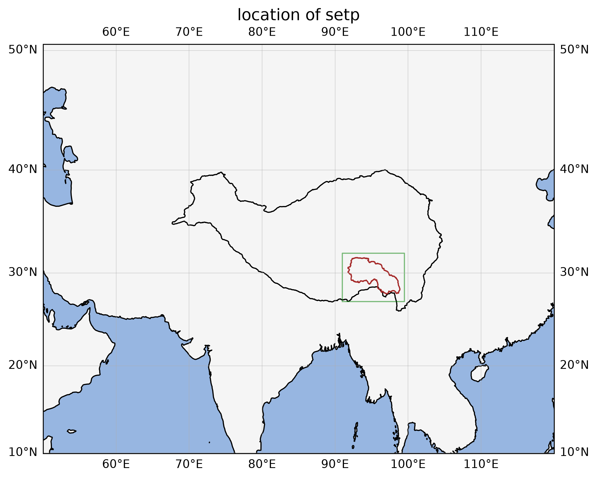
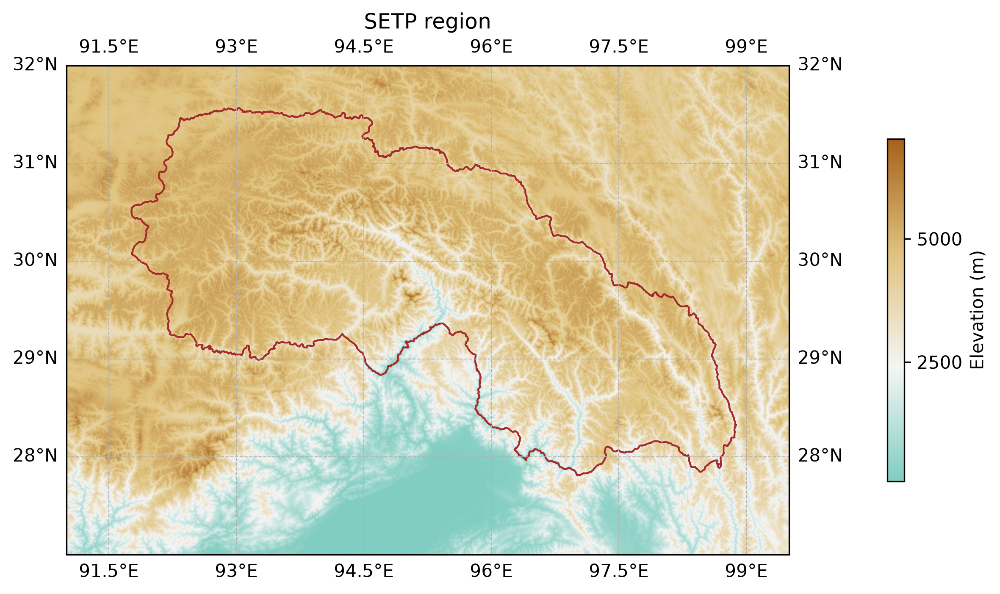
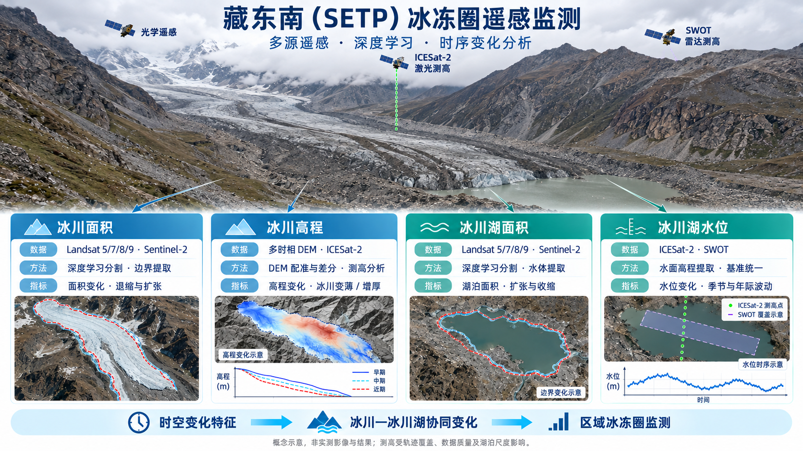

### SETP Crosphere

Crosphere study in Southeastern Tibetan Plateau (SETP).

#### 1. Study area

  
  

##### Reference:

1. Zhang, Y.L., Li, B.Y., Liu, L.S., Zheng, D. (2021). Redetermine the region and boundaries of Tibetan Plateau. GEOGRAPHICAL RESEARCH, 40(6), 1543-1553.
2. Zhao, F.; Long, D.; Li, X.; Huang, Q.; Han, P. Rapid glacier mass loss in the Southeastern Tibetan Plateau since the year 2000 from satellite observations. Remote Sens. Environ. 2022, 270, 112853.

#### 2. Study Contents:

1. glacier lake
   1.1 glacier lake extent (deeplearning)2.2 glacier lake level(icesat-2/swot/s3)
2. glacier/xia2.1 glacier extent (deeplearning)2.2 glacier elevation (aster/kh) 2.3 glacier surge
3. volume/mass change

  

#### Publications

- Luo X, Zeng H, Ye Z. Investigating the Spatiotemporal Variations in Glacier Elevation Changes over the Southeastern Tibetan Plateau Using Multisource Satellite Data[J]. Remote Sensing, 2026, 18(8): 1160.

TODO

1. add rgi70 data of setp region to data/boundary/rgi70.(kang)
2. find and download glacier lake dataset to data/glacier-lake.(liang)
3. find icesat-2 atl13 data glacier lake and download to data/isat-2, code add to data-down/3_isat2_down_UNDO.ipynb (liang, code ref: https://github.com/Hydrological-Observation-Group/laser-altimetry-tool/blob/main/notebooks/data_access.ipynb)
4. add rsimg image download script (gee) to data-down/1_dem_download_UNDO.ipynb (code ref: https://github.com/Hydrological-Observation-Group/hma-water/blob/main/data_down/4_rsimg_down_gee.ipynb), download setp data to data/rsimg/setp-region (1985-2025-5, month 9-10)(kang)
5. add time-series dems (xin luo/hugonnet) to data/glacier/glacier-height(luo)
6. split preproc/1_dem_down_preproc.ipynb into dem_down and dem_preproc (luo)
7. in-site photos for glacier and glacier lake in setp.
